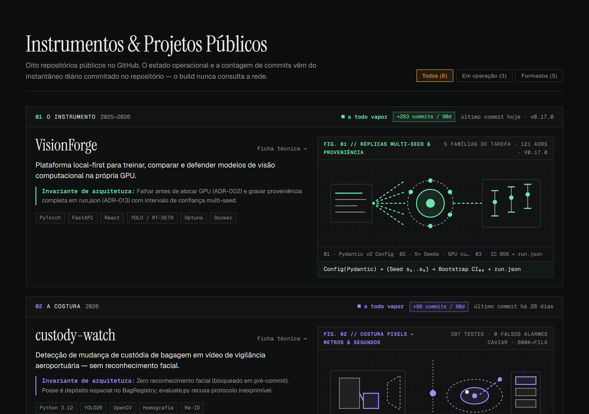
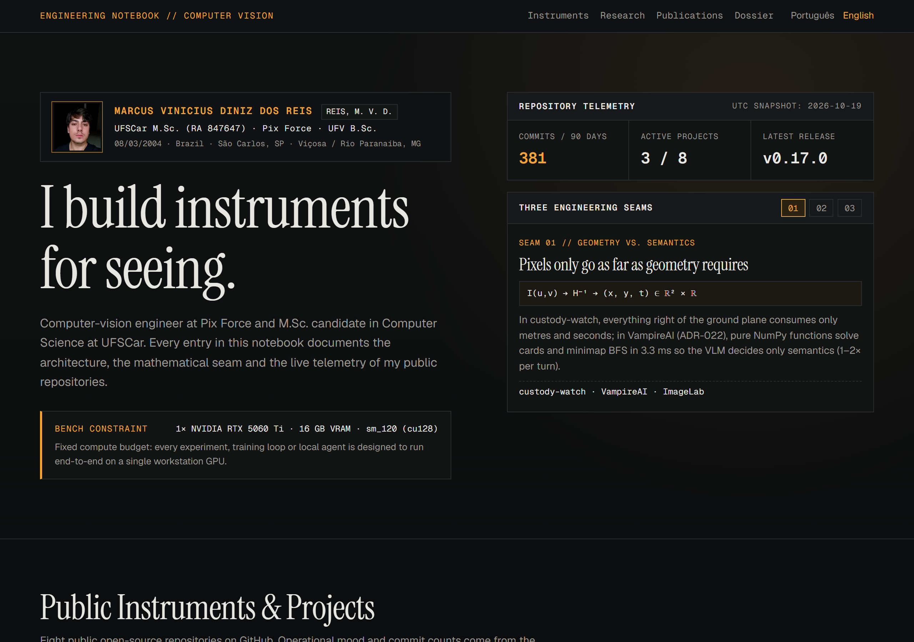

# Caderno de Engenharia & Instrumentos — Marcus Vinicius

A bilingual (PT/EN) engineering notebook and portfolio where every public
repository is presented with its **architectural schematic, mathematical seam,
design invariant, and live telemetry from GitHub**.

*(README in English on purpose: this repository is linked from the site, which
is aimed at both Brazilian and international readers.)*

## The design

Instead of generic project cards or placeholder illustrations, each project is
documented like an **instrument specification sheet**:

1. **Vector Architectural Schematics (`src/components/Schematic.astro`)**: Every
   project renders a custom SVG blueprint of its actual internal pipeline —
   VisionForge's multi-seed bootstrap confidence intervals and `run.json`
   contract, `custody-watch`'s strict pixel-to-metre homography seam,
   VampireAI's ADR-022 split between 3.3 ms NumPy geometry and local 7B VLM
   semantics, AirWatch's dual RabbitMQ queues, ImageLab's spatial/FFT signal
   chain, CoffeeBean's CLAHE + Wavelet CNN ensemble, KNN's MPEG7 descriptor
   boundary, Sorting-Hub's empirical $N = 10 \dots 10^6$ pivot curves, and the
   UFSCar Master's research on filtering ceilings vs. open-vocabulary
   pseudo-label completion.
2. **Hero Calibration & Telemetry Console (`src/components/Hero.astro`)**:
   Displays live repository telemetry aggregated from the committed GitHub
   snapshot alongside an interactive switcher for the three core engineering
   seams (*Geometry vs. Semantics*, *Provenance & Refusal*, *Domain Shift*).
3. **Computed Operational Mood (`src/lib/mood.ts`)**: A daily job reads the
   latest commit across all branches, 90-day commit activity, release tags and
   stars, and crosses that with each project's status:

| Mood | When |
|---|---|
| graduated | the project is finished — university coursework or published study |
| full steam | active, 30 or more commits in 90 days |
| active | active, fewer commits |
| yawning / napping / asleep | paused, for under 90 / 90–180 / over 180 days |

## Architectural invariants

**The build never touches the network.** `npm run refresh:github` writes
`src/data/github-snapshot.json`, which is committed. A GitHub Action refreshes
it daily. The mood's "today" is the snapshot's date, never the system clock, so
every build is reproducible.

**Parity and contrast are enforced by tests.** Missing translations or
frontmatter drift between PT and EN fail the build (`src/lib/parity.ts`,
`tests/unit/project-accents.test.ts`), and every project's dark/light accent
pair is verified against WCAG AA (4.5:1) directly from the real MDX files.

**No display text or hex colour lives in a component.** All copy, schematic
labels, publications, awards and trajectory entries live in
`src/lib/ui-strings.ts` or MDX frontmatter; all colours flow from
`src/lib/tokens.ts` or per-project MDX accents.

| Light mode | English |
|---|---|
|  |  |

## Commands

| Command | What it does |
| :--- | :--- |
| `npm run dev` | Start the dev server |
| `npm run build` | Build the static site to `./dist/` |
| `npm run preview` | Serve the production build locally |
| `npm test` | Unit tests (Vitest) |
| `npm run test:e2e` | End-to-end tests (Playwright) |
| `npm run check` | Type-check, including `.astro` files and tests |
| `npm run refresh:github` | Refresh the GitHub snapshot (needs `GITHUB_TOKEN`) |
| `npm run shots` | Regenerate the screenshots in this README |

See `CLAUDE.md` for the full list of project invariants.
