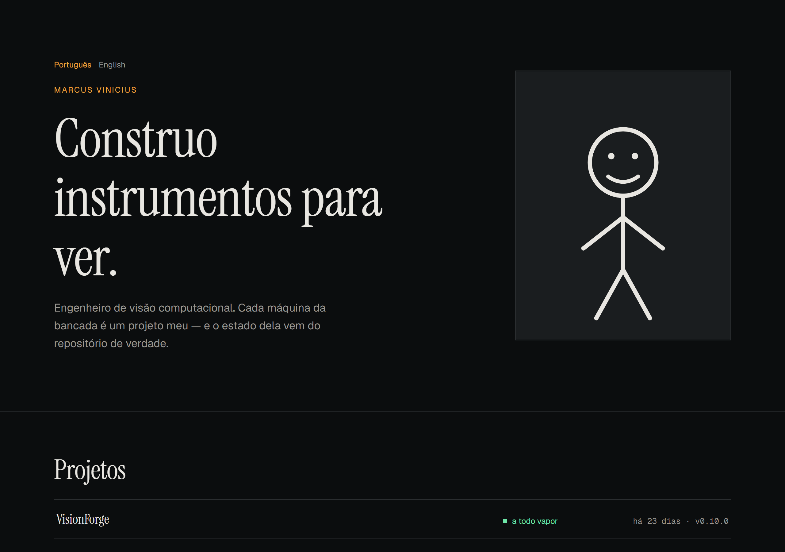
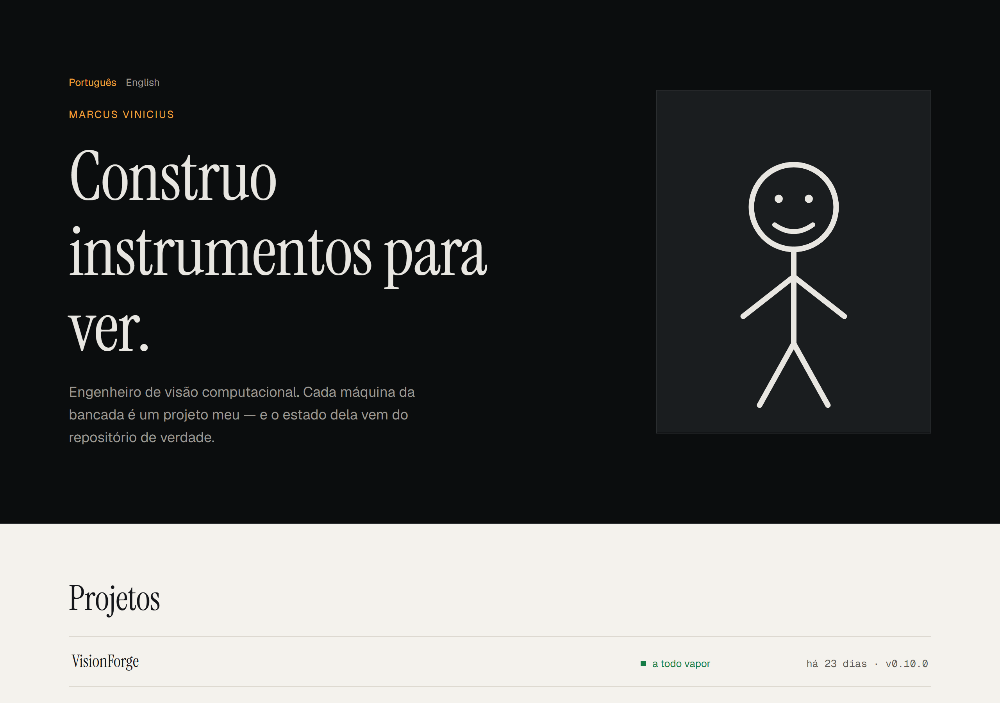
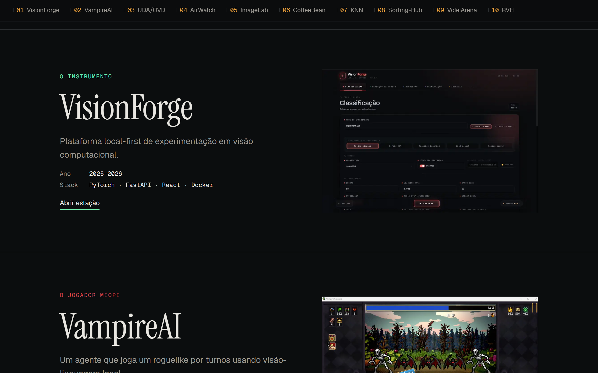
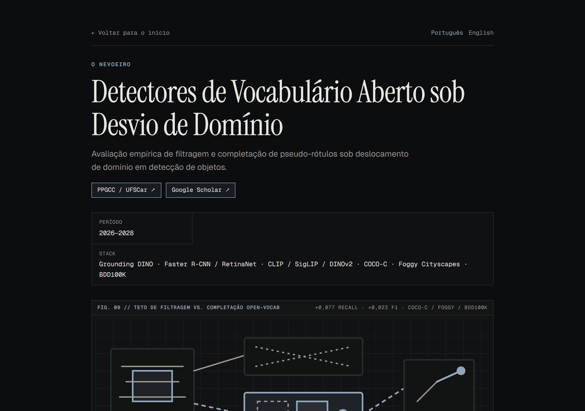
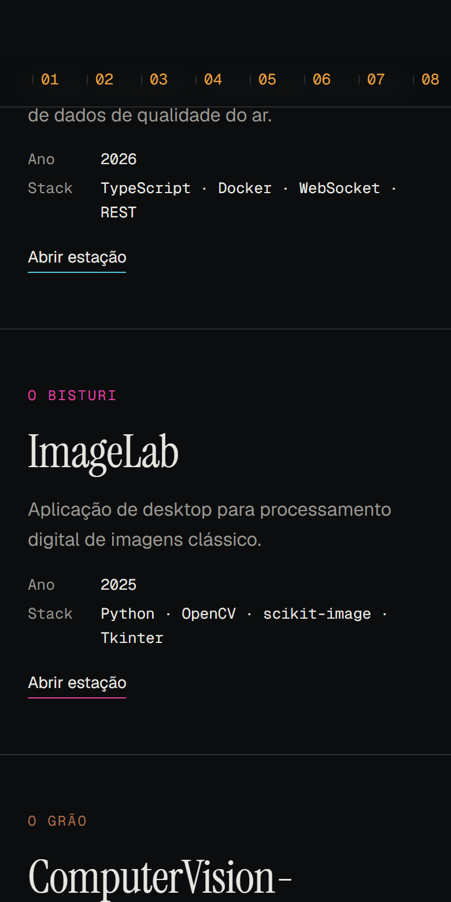
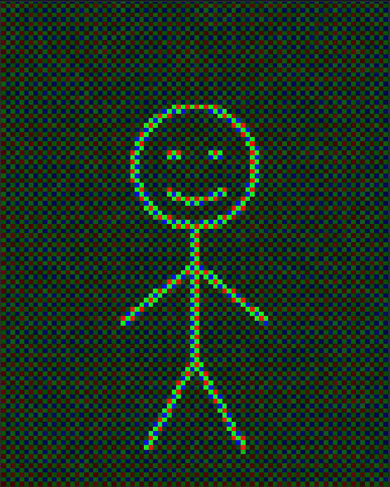
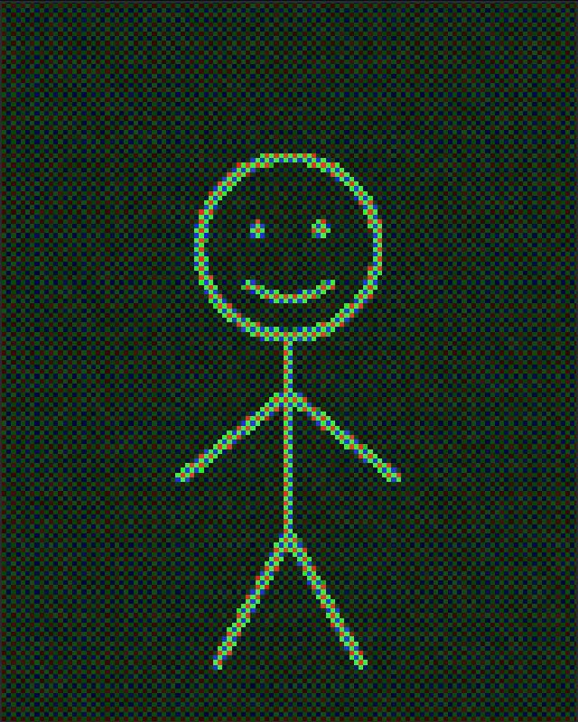
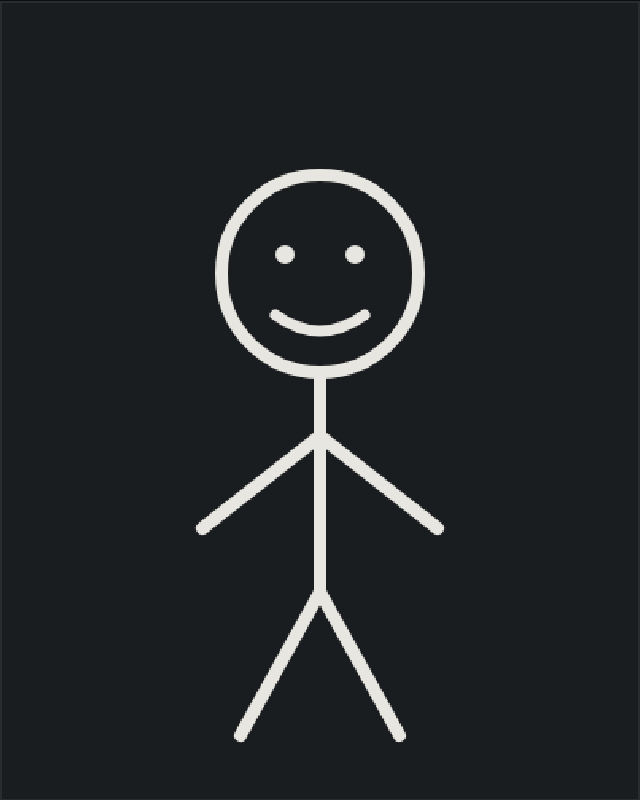

# Optical Bench — Marcus Vinicius's portfolio

A bilingual portfolio built as an **optical bench**: every project is a *station*
on a rail, and each one carries its own persona, accent colour and — as the
project grows — its own behaviour.

*(README in English on purpose: this repository is linked from the site, and the
site is aimed at both Brazilian and international readers.)*

## The idea

The through-line in my work is building **instruments for seeing** — VisionForge
so a researcher can look at their own model without fooling themselves, ImageLab
to expose the operation on the pixel, VampireAI to find out what a small local
model can make of a game screen, and my master's research to make a detector see
under domain shift.

So the site is an instrument too. Rather than dropping ten projects into ten
identical cards, each station gets its own identity, and the plan is for each one
to eventually run its own algorithm live on the page — a fog slider that decays
detection boxes, a filter chain you can drag an image into, a distributed graph
whose nodes you can kill.

This repository is **stage one**: the bilingual foundation, the content layer and
the design system. The WebGL layer and the per-project mechanics come next (see
[Roadmap](#roadmap)).

## Screenshots

| Light mode | A station |
|---|---|
|  |  |

| A project page | English, and mobile |
|---|---|
|  |  |

## The opening

The specimen doesn't fade in — it **resolves**. It starts as a raw Bayer sensor
readout, where each block carries only one of red, green or blue in the RGGB
pattern a real camera sensor uses, plus read noise. Over 1.4 seconds the blocks
shrink to single pixels, the noise falls away and demosaicing fills in the
missing channels. From pixels to a person.

| Raw sensor | Resolving | Resolved |
|---|---|---|
|  |  |  |

It's a hand-written WebGL2 layer — one full-screen quad, one fragment shader, no
library — and it costs **7 kB** of JavaScript, fetched only when the browser can
actually use it. Without WebGL2, or under `prefers-reduced-motion`, no canvas is
created at all and the image is simply there.

The portrait is a **stick figure on purpose** — the real photograph doesn't exist
yet, so the slot ships at its final 4:5 crop with a placeholder standing in.
Swapping it is a one-file change. It will also make the effect land harder: a
bold line drawing survives block quantisation far better than skin tones and soft
gradients do, so the real photo will be much less readable at the start.

## Stack

- **[Astro 7](https://astro.build)**, `output: 'static'` — plain HTML, and
  currently **zero runtime JavaScript**
- Project content as **MDX**, one file per project per language
- Fonts self-hosted via `@fontsource` — Instrument Serif for display, Geist for
  body, Geist Mono for anything numeric
- **[Vitest](https://vitest.dev)** for unit tests, **[Playwright](https://playwright.dev)**
  for end-to-end

## A few things I'd point at

**A missing translation fails the build.** `src/lib/parity.ts` compares the slug
sets of both languages and throws, so the site can never publish half a
translation. It also throws when the collection comes back *empty* — that sounds
paranoid until you notice that a change in how content ids are generated would
otherwise let the build succeed while publishing nothing at all.

**Colour contrast is a test, not a hope.** `src/lib/tokens.ts` is the single
source of truth for the palette, and `tests/unit/tokens.test.ts` asserts WCAG AA
on every pair in both modes. That test is why the site's amber has a second,
darker value for light mode — `#F0A33C` scores 1.88 on paper.

The same idea covers the ten per-project accents, in
`tests/unit/project-accents.test.ts`, which reads the MDX files off disk so it
can never drift from what ships. Every accent is a **pair**: a colour picked
against dark graphite almost never survives light mode. Nine of the original ten
didn't.

**Routing is one pure function.** `src/lib/i18n.ts` parses a path into a
canonical route and rebuilds it in the target language, so the language toggle
carries you from `/projeto/uda-ovd` to `/en/project/uda-ovd` without string
surgery scattered across components.

**No display text lives in a component.** It's all in `src/lib/ui-strings.ts`
or in MDX frontmatter.

Current state: **95 unit tests, 5 end-to-end, 22 pages, Lighthouse 100/100/100.**

## Commands

| Command | What it does |
| :--- | :--- |
| `npm run dev` | Start the dev server |
| `npm run build` | Build the static site to `./dist/` |
| `npm run preview` | Serve the production build locally |
| `npm test` | Unit tests (Vitest) |
| `npm run test:e2e` | End-to-end tests (Playwright) |
| `npm run check` | Type-check, including `.astro` files |
| `npm run shots` | Regenerate the screenshots in this README |

## Roadmap

- [x] **Stage 1 — bilingual foundation.** Content, routing, design tokens, rail,
  stations, project pages, tests, CI.
- [ ] **Stage 2 — the WebGL engine.** A hand-written WebGL2 canvas (one
  full-screen quad, one fragment shader per station), crossfades driven by scroll
  position, and static posters pre-rendered at build time from the same shaders
  for `prefers-reduced-motion`.
- [ ] **Stage 3 — the stations.** One shader and one interactive mechanic per
  project, in order of value.

See `CLAUDE.md` for the project's invariants, and `docs/superpowers/` for the
design spec and implementation plans.
